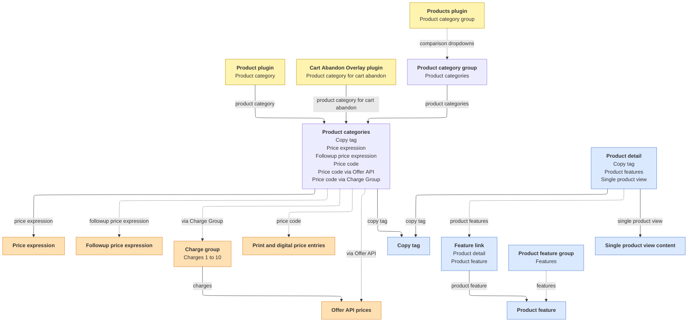

The **Products: V3** section of the admin holds the data that the [Products](/plugins/products) plugin renders: what each offer is called, what it costs, what it includes and what its overlay shows. A page never stores any of this. Each [Product](/plugins/products/product) plugin points at a **product category**, and everything else is looked up from there when the page loads, for the visitor's country. The same section holds the product category for cart abandon that a [Cart Abandon Overlay](/plugins/cart-abandon-overlay) points at.

## Entities

| Admin entity | What it holds | Page |
| --- | --- | --- |
| **Product categories** | The offer: type, copy tag, price codes and expressions, sign-up link | [Product category](/products-v3/product-category) |
| **CUSTOM: Product category for cart abandon** | The offer behind the Cart Abandon Overlay: copy tag, label, heading, optional description, price codes, sign-up link | [Product category for cart abandon](/products-v3/cart-abandon-category) |
| **Copy tags** | The name that ties a product category to its product details | _to follow_ |
| **Product details** | The copy for one copy tag in one country: name, description, packshot, label, features and the **Single product view** content | _to follow_ |
| **Product features** | A reusable feature line with up to five parameters, shown in the overlay and the comparison table | _to follow_ |
| **Product feature groups** | Ordered sets of features that group the rows of the comparison table | _to follow_ |
| **Price expressions** | How the primary price is written, for example `#price# per month`, and its billing period | _to follow_ |
| **Followup product expressions** | How the follow-up price is written, typically the price after an introductory period | _to follow_ |
| **Product category groups (for comparison page dropdowns)** | Named sets of product categories offered in the comparison dropdowns on top of the products on the page | _to follow_ |

## How the entities relate

Each box is one entity. Only the fields that link it to other entities are listed, not the entity's full set of fields. **Product categories** stands for both kinds of category, see [Product categories](#product-categories) below; the follow-up price expression belongs to the regular one only. The full price and follow-up price slots repeat the three price code fields. Solid arrows are required links, dotted arrows optional ones. Click an entity's name to open its page.

  CMS plugin on the page
  Prices
  Copy
  Product categories and their groups

## Product categories

The **Product categories** box of the diagram stands for two kinds of entity. Both connect to a copy tag and a price expression and carry the same price code fields; they differ in what they are for.

| Entity | What it is for | Page |
| --- | --- | --- |
| **Product categories** | The offers of a [Products](/plugins/products) widget: each Product plugin points at one. It has a type, and it can carry a follow-up price. | [Product category](/products-v3/product-category) |
| **CUSTOM: Product category for cart abandon** | The offer of a [Cart Abandon Overlay](/plugins/cart-abandon-overlay). It has no type and no follow-up price, and it carries the label, heading and description the overlay shows. | [Product category for cart abandon](/products-v3/cart-abandon-category) |

## Drafts and publishing

Every entity in this section exists in two forms: a **draft** and a **published** version.

- The draft is the working copy and the only one you can add to, edit or delete. The switch at the top right of every Products admin page tells you which one you are looking at: **You are viewing draft repository** or **You are viewing published repository**. **Switch to draft** and **Switch to published** flip between them. The choice is remembered per browser and has no effect on visitors.
- The published version is read-only. It shows every entity as it was when last published.
- **Publish prices & products**, available in the draft view after a confirmation, makes the current drafts the published version, replacing what was published before. It publishes the whole product manager at once, prices and V1&V2 products included, not a single entity. The drafts stay as they are, ready for the next round of edits.
- Live pages read the published version. A page open in the CMS editor reads the drafts instead, so you can check draft products on a page before publishing them. Publishing clears the site cache, so the change is live straight away.
